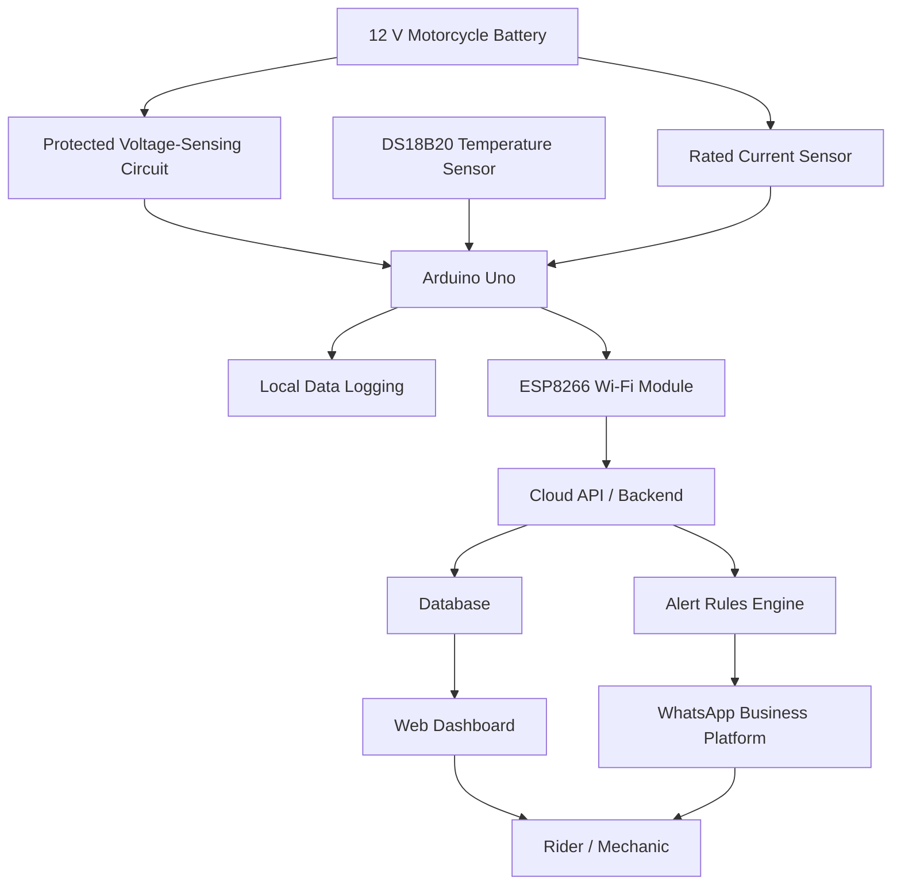
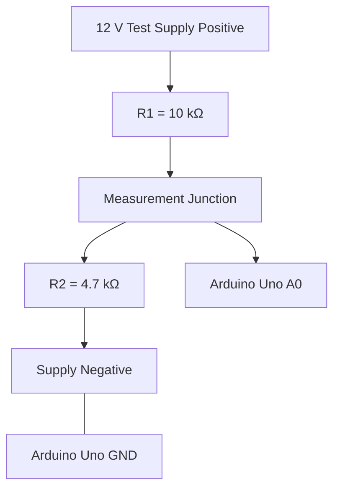
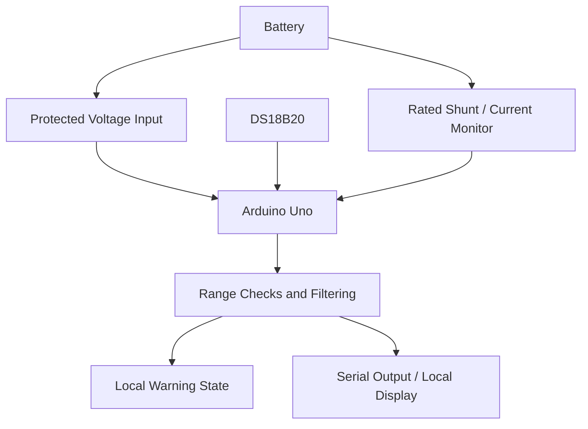
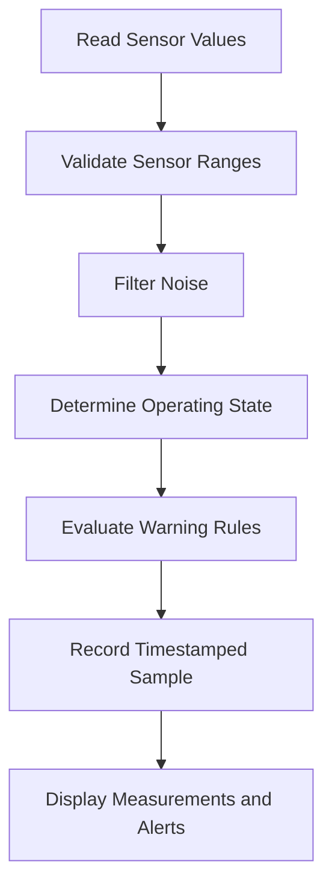
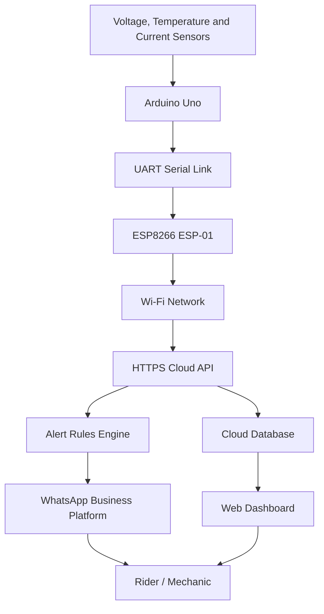
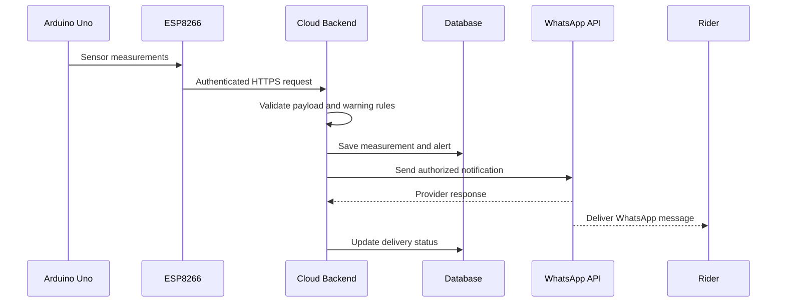

# IoT-Driven Battery Health Monitoring Framework for ICE Two-Wheelers
## System Architecture and Implementation Document

**Version:** 1.0  
**Platform:** Arduino Uno + ESP8266  
**Application:** 12 V lead-acid battery monitoring for internal combustion engine (ICE) two-wheelers  
**Implementation scope:** Stage 1 to Stage 4  
**Primary objective:** Detect battery warning conditions, monitor electrical parameters, log measurements, and notify riders through WhatsApp.

---

## 1. Project Overview

### 1.1 Problem statement

Conventional ICE two-wheelers generally do not provide continuous battery-health monitoring. Riders may discover battery problems only when the starter fails or the motorcycle becomes difficult to start.

This project proposes a low-cost monitoring system using an Arduino Uno, electrical sensors, an ESP8266 Wi-Fi module, cloud storage, and WhatsApp notifications.

The system will monitor battery voltage and temperature, add current measurements where appropriate, analyze voltage changes during starting and charging, and transmit selected readings to a cloud service.

### 1.2 Project objectives

1. Measure battery voltage continuously or at configurable intervals.
2. Monitor battery temperature.
3. Measure battery current safely within the chosen sensor's operating range.
4. identify low-voltage, abnormal-temperature, and charging-related warning conditions.
5. Record measurements to analyze battery behavior over time.
6. Estimate battery condition using multiple measurements rather than voltage alone.
7. Provide a wireless upgrade path using ESP8266.
8. Send remote alerts through the official WhatsApp Business Platform.

### 1.3 Scope and limitations

The initial prototype targets conventional 12 V lead-acid motorcycle batteries. AGM and other lead-acid variants may require different interpretation thresholds. Lithium-based motorcycle batteries require their own specifications and warning rules.

The system is a monitoring prototype, not a replacement for a certified battery tester or the motorcycle's original electrical protection.

---

## 2. Overall System Architecture

The design is divided into four implementation stages.

- **Stage 1:** Arduino Uno voltage monitoring.
- **Stage 2:** Temperature and current sensing.
- **Stage 3:** Battery behavior analysis and local data logging.
- **Stage 4:** ESP8266 connectivity, cloud storage, dashboard, and WhatsApp notifications.

### 2.1 High-level architecture diagram



**Data flow:** Sensors → Arduino Uno → ESP8266 → cloud backend → database and alert engine → dashboard or WhatsApp.

The Arduino Uno performs measurement and basic decision-making. The cloud backend handles long-term storage, remote access, and notification delivery.

---

## 3. Hardware Requirements

### 3.1 Primary components

| Component | Purpose | Stage |
|---|---|---|
| Arduino Uno R3 | Sensor processing and local logic | 1–4 |
| 10 kΩ and 4.7 kΩ resistors | Basic voltage divider | 1 |
| Input protection circuit | Protects the analog input from electrical faults and transients | 1–4 |
| DS18B20 temperature sensor | Battery surface temperature | 2 |
| INA226 with suitably rated shunt | Voltage/current monitoring for an appropriately sized current path | 2 |
| High-current Hall-effect sensor | Optional starter-current measurements | 3 |
| MicroSD module or serial logger | Local measurement storage | 3 |
| ESP8266 ESP-01 or compatible module | Wi-Fi connectivity | 4 |
| Regulated 3.3 V power supply | Powers the ESP8266 | 4 |
| Logic-level interface | Protects ESP8266 serial inputs from 5 V signals | 4 |
| Fuse and automotive power protection | Installation safety | 1–4 |
| Computer and Arduino IDE | Programming and debugging | 1–4 |

### 3.2 Component-selection notes

**Voltage sensing:** A resistor divider is sufficient for a bench prototype. A vehicle installation requires appropriate reverse-polarity, transient, filtering, and overvoltage protection.

**Temperature sensing:** Use a DS18B20 probe attached securely to the battery case. It measures surface temperature, not internal battery temperature.

**Current sensing:** An INA226 measures current through an external shunt. The board and shunt must be rated for the monitored circuit. A small hobby module must not be inserted into a starter-motor circuit. Use a suitable high-current Hall-effect sensor for starter-current measurement.

**Power supply:** The Arduino and ESP8266 must not be powered directly from an unregulated motorcycle battery. Use a properly designed automotive input supply that tolerates cranking and transient conditions.

---

# Stage 1 — Basic Voltage Monitoring

## 4. Stage 1 Design

### 4.1 Purpose

The first stage verifies that the Arduino Uno can read battery voltage, calculate the estimated battery voltage, display the reading, and activate a warning when a configurable threshold is crossed.

No Wi-Fi or cloud account is required.

### 4.2 Voltage-divider circuit

For an initial bench prototype, use a 10 kΩ resistor between the positive test supply and A0, and a 4.7 kΩ resistor between A0 and ground.



### 4.3 Wiring table

| From | To |
|---|---|
| Supply positive | R1, 10 kΩ |
| Other end of R1 | Junction |
| Junction | Arduino A0 |
| Junction | R2, 4.7 kΩ |
| Other end of R2 | Supply negative |
| Supply negative | Arduino GND |

The divider output is calculated as:

\[
V_{A0}=V_{battery}\frac{R_2}{R_1+R_2}
\]

For the specified resistors:

\[
V_{battery}=V_{A0}\frac{14.7}{4.7}
\]

At a 14.5 V supply, A0 receives approximately 4.63 V. Actual values depend on resistor tolerances and the Arduino's analog reference.

**Safety requirement:** Begin with a low-voltage, current-limited bench supply. Verify the A0 voltage with a multimeter before increasing the test voltage. Do not connect this unprotected divider directly to a motorcycle battery. A vehicle-ready circuit needs suitable input protection, a correctly selected fuse, reverse-polarity protection, filtering, and transient suppression.

### 4.4 Firmware responsibilities

The Arduino firmware must:

1. Read A0 several times.
2. Average the samples to reduce noise.
3. Convert the ADC value into an input voltage.
4. Apply the divider ratio.
5. Compare the result against configurable thresholds.
6. Print the voltage and warning state through the Serial Monitor.
7. Repeat the measurement at a defined interval.

Example measurement logic:

```cpp
const int batteryPin = A0;

const float referenceVoltage = 5.0;
const float R1 = 10000.0;
const float R2 = 4700.0;

void setup() {
  Serial.begin(9600);
}

void loop() {
  long total = 0;

  for (int i = 0; i < 20; i++) {
    total += analogRead(batteryPin);
    delay(5);
  }

  float adc = total / 20.0;
  float pinVoltage = adc * referenceVoltage / 1023.0;
  float batteryVoltage = pinVoltage * (R1 + R2) / R2;

  Serial.print("Voltage: ");
  Serial.print(batteryVoltage, 2);
  Serial.println(" V");

  delay(2000);
}
```

This is a basic bench-test example, not a complete automotive-ready firmware implementation. Calibrate the analog reference and divider against a multimeter before relying on the measurements.

### 4.5 Stage 1 acceptance criteria

- The Arduino uploads and runs the firmware.
- The Serial Monitor displays a stable reading.
- Calculated voltage agrees with the multimeter within the chosen tolerance.
- Warning thresholds can be adjusted without changing the measurement circuit.
- Sensor disconnection or implausible readings are detected rather than silently treated as a healthy battery.

---

# Stage 2 — Temperature and Current Monitoring

## 5. Stage 2 Design

The second stage adds temperature and current measurements. These measurements help explain battery behavior beyond resting voltage.

### 5.1 Temperature sensor: DS18B20

The DS18B20 is a digital temperature sensor with a one-wire interface.

**Connections:**

| DS18B20 pin | Arduino Uno |
|---|---|
| VDD | 5 V, for a suitable 5 V-powered probe |
| GND | GND |
| DATA | D2 |
| Pull-up resistor | 4.7 kΩ between DATA and 5 V |

Check the pinout of the specific sensor or probe before wiring it.

The firmware should read temperature periodically, validate the sensor result, and generate a warning if the temperature exceeds a threshold appropriate to the battery manufacturer's specifications.

### 5.2 Current sensor: INA226

The INA226 is a current and voltage monitor that measures voltage across a shunt resistor. It communicates over I²C.

**Typical Arduino Uno I²C connections:**

| INA226 signal | Arduino Uno |
|---|---|
| SDA | A4 |
| SCL | A5 |
| GND | GND |
| VCC | According to the breakout board's specifications |

The current-carrying terminals must be wired according to the specific breakout board's schematic. Verify the board's voltage range, shunt rating, current capacity, and I²C voltage compatibility.

Do not assume that every INA226 breakout is suitable for motorcycle battery current.

### 5.3 Stage 2 architecture



### 5.4 What these measurements tell us

| Measurement | Interpretation |
|---|---|
| Resting voltage | Approximate state of charge under appropriate conditions |
| Battery surface temperature | Thermal context for readings |
| Charging current | Whether current is entering the monitored battery path |
| Discharge current | Whether current is leaving the monitored battery path |
| Voltage during starting | How much the battery voltage falls under starting load |
| Charging voltage | Whether the charging system appears to be operating within its specified range |

A current sensor only measures the circuit through which it is installed. A sensor measuring accessories will not necessarily measure starter-motor current.

### 5.5 Stage 2 acceptance criteria

- Temperature readings agree reasonably with a reference thermometer.
- Current measurements agree with an appropriate reference instrument.
- Sensor faults and out-of-range measurements are flagged.
- The firmware reports units, timestamps or elapsed time, and sensor validity.
- No component exceeds its electrical or thermal rating during testing.

---

# Stage 3 — Battery Behavior Analysis and Local Logging

## 6. Stage 3 Design

Stage 3 converts individual measurements into useful diagnostic information and stores data over time.

### 6.1 Measurements to capture

For each sample, record:

- Timestamp or elapsed time
- Battery voltage
- Battery surface temperature
- Current and current direction, if supported
- Operating state: resting, cranking, charging, or unknown
- Warning state
- Sensor-validity flags

A local MicroSD card is optional. A computer connected through USB can also record Serial Monitor output during early tests.

### 6.2 Data-processing pipeline



### 6.3 Operating-state interpretation

**Resting:** The battery is not under a substantial load and has had an appropriate period to stabilize. Resting voltage can help estimate state of charge.

**Cranking:** Voltage falls while the starter draws substantial current. A short-duration voltage drop is more informative when recorded alongside current and temperature.

**Charging:** Voltage and current are observed while the engine runs. Interpret them against the motorcycle manufacturer's specifications.

**Unknown:** The system cannot reliably classify the operating state. Do not force a classification when readings are missing or inconsistent.

The initial system can use user-selected operating states during testing. Automatic classification can be developed later.

### 6.4 Battery-health estimation

A useful prototype should distinguish between:

- **State of charge (SoC):** How charged the battery currently is.
- **State of health (SoH):** How much usable capacity or performance remains compared with the battery's expected or original condition.

Voltage alone cannot reliably estimate SoH. A stronger evaluation combines voltage trends, temperature, load response, current measurements, and comparison against a reference test.

A simplified dynamic resistance estimate can be calculated under a controlled load change:

\[
R_{\text{effective}}\approx\frac{|\Delta V|}{|\Delta I|}
\]

This is an approximate effective resistance, not a definitive internal-resistance or SoH measurement. Consistent conditions and reference tests are required.

### 6.5 Warning-rule design

| Rule | Condition | Action |
|---|---|---|
| Low voltage | Resting voltage below a calibrated threshold | Flag for checking or charging |
| Unexpected voltage drop | Voltage falls more than the configured amount under a comparable load | Recommend further testing |
| Temperature warning | Temperature exceeds a specified safe limit | Raise a thermal warning |
| Charging anomaly | Charging voltage or current is outside the specified range | Recommend charging-system inspection |
| Sensor fault | Missing, invalid, or implausible reading | Mark the sample invalid |

Thresholds must be configurable and battery-specific. A reading below a resting-voltage threshold should not automatically be interpreted as proof of battery failure.

### 6.6 Example local log format

```csv
timestamp,battery_voltage,temperature_c,current_a,state,warning
2026-10-24T10:00:00,12.65,28.4,0.02,resting,none
2026-10-24T10:00:02,12.58,28.4,0.15,discharging,none
```

These rows are illustrative only, not real test results.

### 6.7 Stage 3 acceptance criteria

- Data is recorded at a predictable sampling interval.
- Missing and invalid measurements are clearly marked.
- Warning rules can be tested using controlled input values.
- Logs can be exported for analysis.
- Resting, cranking, and charging data can be compared where each state is measured reliably.

---

# Stage 4 — ESP8266, Cloud Backend, Dashboard and WhatsApp

## 7. Stage 4 Design

The Arduino Uno remains the sensor controller. The ESP8266 adds Wi-Fi and forwards measurements to a cloud backend.

For a simple prototype, use an ESP8266 ESP-01 with a suitable regulated 3.3 V power supply and a safe serial interface.

### 7.1 Connectivity architecture



### 7.2 ESP8266 electrical requirements

The ESP8266 uses 3.3 V logic and is not 5 V tolerant.

- Provide a stable, regulated 3.3 V supply capable of handling the module's peak current demand.
- Add suitable local decoupling capacitors near the module.
- Ensure the Arduino and ESP8266 share a common ground.
- Use a level shifter or suitable resistor divider on the Arduino TX-to-ESP8266 RX connection.
- Verify the exact ESP-01 pinout before wiring.
- Keep the ESP8266's boot-configuration pins in their required states.

Do not assume that the Arduino Uno's onboard 3.3 V output can reliably power the ESP8266.

### 7.3 Serial communication

The Uno can communicate with the ESP8266 using a serial link. During development, a software serial interface may be used to preserve the hardware serial port for USB debugging.

A simple message from the Uno could look like:

```json
{
  "device_id": "bike_001",
  "voltage_v": 12.58,
  "temperature_c": 28.4,
  "current_a": 0.15,
  "state": "resting",
  "warning": "none"
}
```

This is an example payload. The values must come from actual sensor readings.

Use a documented serial protocol with message boundaries, validation, and error handling. The ESP8266 should reject incomplete or malformed messages rather than forwarding corrupted data.

### 7.4 Cloud backend responsibilities

The backend receives sensor data, validates the payload, stores the measurement, and evaluates warning rules.

Recommended responsibilities:

1. Authenticate the device or its provisioned credentials.
2. Validate data types, units, ranges, and timestamps.
3. Store measurements in a database.
4. Apply configurable warning rules.
5. Deduplicate repeated alerts.
6. Expose recent readings to a dashboard.
7. Send WhatsApp notifications when required.
8. Track delivery failures and API errors.

The backend should not assume that a missing reading means the battery is healthy.

### 7.5 Suggested technology stack

| Layer | Suggested choice |
|---|---|
| Sensor controller | Arduino Uno firmware |
| Wi-Fi bridge | ESP8266 ESP-01 |
| Data transport | HTTPS requests to a cloud endpoint |
| Backend | Python FastAPI or a serverless endpoint |
| Database | Supabase PostgreSQL or another suitable database |
| Dashboard | Lightweight web application |
| Notifications | Official WhatsApp Business Platform API |

The stack can be simplified for a student prototype. Select one cloud provider and one database rather than integrating multiple services at once.

### 7.6 Suggested API contract

**Endpoint:** `POST /api/v1/measurements`

Example request:

```json
{
  "device_id": "bike_001",
  "timestamp": "2026-10-24T10:00:00Z",
  "battery_voltage_v": 12.58,
  "battery_temperature_c": 28.4,
  "battery_current_a": 0.15,
  "operating_state": "resting",
  "sensor_valid": true
}
```

The backend should return a success or error status and a unique measurement identifier when the request is accepted.

The device must retry temporary failures carefully and avoid repeatedly transmitting the same record without an idempotency strategy.

### 7.7 Database design

A minimal schema could include three tables.

**Devices**

| Field | Purpose |
|---|---|
| device_id | Unique device identifier |
| vehicle_label | Human-readable motorcycle label |
| owner_id | Authorized user reference |
| created_at | Registration time |
| enabled | Whether the device is active |

**Measurements**

| Field | Purpose |
|---|---|
| id | Unique measurement ID |
| device_id | Device reference |
| recorded_at | Measurement timestamp |
| battery_voltage_v | Measured voltage |
| battery_temperature_c | Measured temperature |
| battery_current_a | Measured current |
| operating_state | Resting, cranking, charging, or unknown |
| sensor_valid | Measurement validity |

**Alerts**

| Field | Purpose |
|---|---|
| id | Unique alert ID |
| device_id | Device reference |
| alert_type | Low voltage, temperature, charging, or sensor fault |
| created_at | Alert creation time |
| status | Pending, sent, failed, or acknowledged |
| delivery_reference | Provider message reference when available |

Store only necessary user data and restrict access by device ownership or role.

### 7.8 WhatsApp notification flow



The backend, rather than the Uno, should call the WhatsApp API. This keeps API credentials out of the microcontroller firmware and makes notification retries easier to manage.

WhatsApp integration requires an appropriately configured Meta business account, a registered or authorized sender, access credentials, and approved templates where applicable. User opt-in and applicable messaging rules must be respected.

Example notification:

> **Battery Warning — Bike 001**
>
> Battery voltage: 11.9 V  
> Condition: Low voltage detected  
> Recommendation: Check battery charge and starting performance.
>
> This reading is a warning indicator, not a definitive battery-failure diagnosis.

### 7.9 Security and reliability

- Do not hard-code WhatsApp access tokens in the Arduino firmware.
- Protect backend endpoints using device credentials or an appropriate authentication mechanism.
- Use HTTPS for cloud communication.
- Validate all incoming data and rate-limit requests.
- Avoid sending repeated alerts for every sample below a threshold.
- Use hysteresis and a cooldown period to reduce notification spam.
- Detect stale data and show the last successful update time.
- Keep Wi-Fi credentials and device provisioning information protected.
- Configure a safe local behavior when Wi-Fi is unavailable.

### 7.10 Stage 4 acceptance criteria

- The ESP8266 joins the configured Wi-Fi network.
- The Uno transmits valid sensor records to the ESP8266.
- The backend accepts authenticated requests.
- Measurements appear in the database and dashboard.
- Simulated warning conditions trigger the expected notification.
- Repeated measurements do not generate excessive duplicate alerts.
- A Wi-Fi outage does not disable local sensor monitoring.

---

# 8. Testing and Validation Plan

Testing should proceed from the simplest circuit to the complete system.

| Test | Method | Expected result |
|---|---|---|
| Voltage accuracy | Compare with multimeter | Readings agree within a defined tolerance |
| Temperature accuracy | Compare with reference thermometer | Readings are within sensor tolerance |
| Current accuracy | Compare with an appropriate reference meter | Readings are within the designed tolerance |
| Sensor fault | Disconnect or simulate invalid sensor data | Fault is reported |
| Threshold test | Use safe simulated input values | Correct warning state is generated |
| Data logging | Record measurements over time | Timestamps and readings are retained |
| Wi-Fi failure | Disconnect the access point | Local monitoring continues |
| API failure | Return an error from the backend | Retry or failure handling works |
| WhatsApp test | Trigger a simulated warning | One correctly formatted alert is sent |
| Vehicle validation | Test with protected automotive hardware | Readings remain stable across operating conditions |

Do not simulate a low-voltage condition by shorting a battery or deliberately creating a fault in a motorcycle's electrical system. Use controlled bench inputs and test fixtures.

---

# 9. Safety and Engineering Constraints

1. **Vehicle voltage protection:** Motorcycle electrical systems can experience transients, reverse polarity, and voltage disturbances. The resistor-divider example is not a complete vehicle-ready input stage.
2. **Starter current:** Starter motors can draw very high current. Use appropriately rated sensors and wiring; never route starter current through a small breadboard or an underrated shunt.
3. **Power conversion:** Use a properly designed automotive power supply for the Uno and a stable 3.3 V rail for the ESP8266.
4. **Battery chemistry:** Configure the measurement thresholds for the actual battery type and manufacturer specifications.
5. **Temperature:** A surface temperature sensor does not directly measure internal battery temperature.
6. **Health estimation:** Report a warning or estimated condition with uncertainty rather than claiming definitive battery failure based on one reading.
7. **Installation:** Fuse the vehicle-side power connection near the battery and use insulated, mechanically secure wiring.
8. **Data integrity:** Missing, stale, or invalid measurements must not be interpreted as healthy readings.

---

# 10. Final Implementation Roadmap

| Milestone | Deliverable |
|---|---|
| Stage 1 | Calibrated voltage monitor running on Arduino Uno |
| Stage 2 | Voltage, temperature, and appropriately rated current measurement |
| Stage 3 | Measurement logging, operating-state analysis, and warning rules |
| Stage 4 | ESP8266 connectivity, cloud database, dashboard, and WhatsApp alerts |

### Recommended implementation order

Build the protected voltage-sensing circuit and verify it with a bench supply first. Add temperature sensing next, then current monitoring. Once the sensor readings are stable and calibrated, implement logging and warning rules. Add the ESP8266 and cloud backend only after the local monitoring system works reliably.

The resulting prototype will demonstrate a practical, staged approach to IoT battery monitoring for ICE two-wheelers, while keeping the sensor system, diagnostic logic, wireless communication, and notification service as separate components that can be tested independently.
